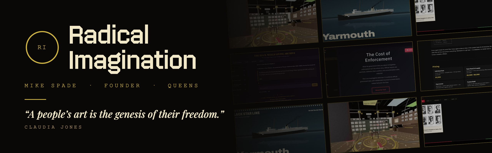
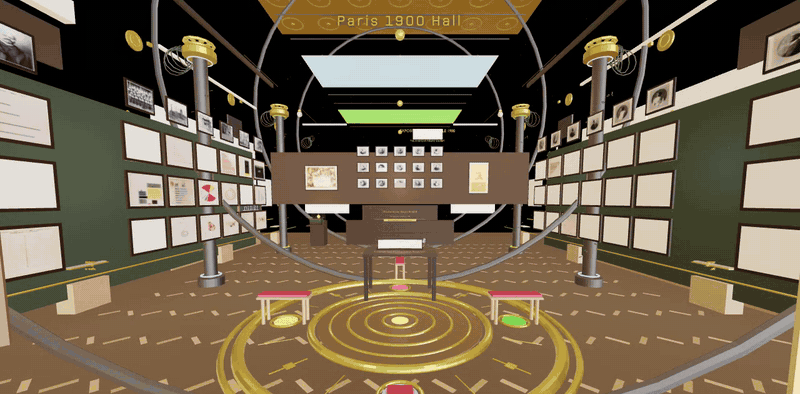
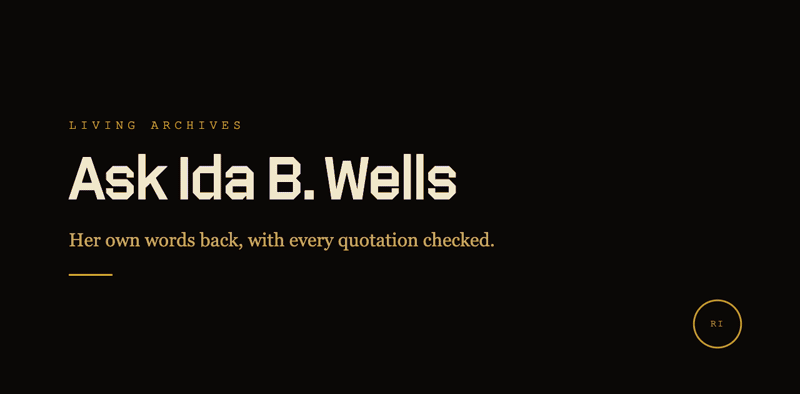
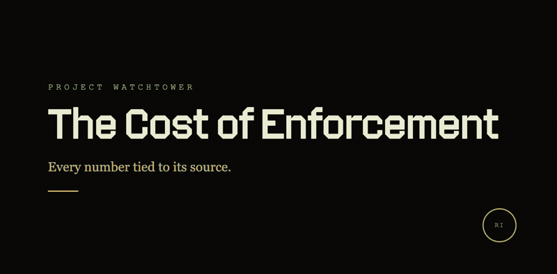
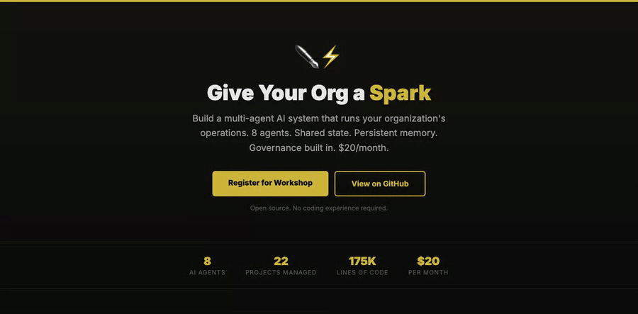

I'm Mike Spade. I run [Radical Imagination](https://radicalimagination.xyz), a cultural technology studio in Queens. We make VR rooms, searchable archives and games out of historical records, and we show where each piece of history comes from.

Recent work: Du Bois Does Data at the Oculus in the World Trade Center, with CUNY's Public Interest Technology Lab, for Juneteenth (June 19 to 21, 2026). [Legacy Lectures](https://radicalimagination.xyz/legacy-lectures/), a six-session course on Marcus Garvey with the Black Star Archive, fall 2026.

During the day I lead teaching and learning at [The Knowledge House](https://theknowledgehouse.org) in the Bronx.

### Projects

<table>
<tr>
<td width="50%" valign="top">

<b><a href="https://github.com/ShdwSpde/du-bois-paris-hall">Du Bois Does Data: the Paris 1900 Hall</a></b> 
A walk-through model of the hall at the 1900 Paris Exposition where W.E.B. Du Bois and his Atlanta University students showed their hand-drawn charts of Black life in America. Runs in a browser or a VR headset. <a href="https://radicalimagination.xyz/demos/paris-hall.mp4">Demo video</a>

</td>
<td width="50%" valign="top">

<b><a href="https://github.com/ShdwSpde/living-archives">Living Archives</a></b> 
Ask Ida B. Wells, Du Bois or Garvey a question. The answer quotes their writing and names the book and chapter, and a checker compares each quote with the original text before it's shown. <a href="https://radicalimagination.xyz/demos/living-archives.mp4">Demo video</a>

</td>
</tr>
<tr>
<td width="50%" valign="top">

<b><a href="https://github.com/ShdwSpde/garvey">The Marcus Garvey Living Archive</a></b> 
Garvey's writing, the movement's photographs and documents, and his 1921 recordings in one search. Made with Dr. Jewell Humphrey and the Black Star Archive. <a href="https://radicalimagination.xyz/demos/garvey.mp4">Demo video</a>

</td>
<td width="50%" valign="top">

<b><a href="https://black-star-fleet.vercel.app">The Replica Collection</a></b> 
Scale models of the Black Star Line's ships, built in code from period records. You can run them and take them apart, and each part lists its source.

</td>
</tr>
<tr>
<td width="50%" valign="top">

<b><a href="https://icedata.xyz">Project Watchtower</a></b> 
What U.S. immigration enforcement costs, traced through budget, detention and deportation data. Led by Julisa Esparza.

</td>
<td width="50%" valign="top">

<b><a href="https://github.com/ShdwSpde/spark-workshop-template">Spark</a></b> 
The set of AI agents our studio runs on, built with Claude Code. It handles grants, curriculum, archives and reviews. The repo is a template you can fork. <a href="https://radicalimagination.xyz/demos/spark.mp4">Demo video</a>

</td>
</tr>
</table>

### Other repos

- [Ghost Dollars](https://github.com/ShdwSpde/ghost-dollars): a map of New York City's capital spending by community district, including the money the city's data can't place.
- [Du Bois Does Data notebooks](https://github.com/ShdwSpde/dubois-does-data-notebooks): Colab notebooks that rebuild Du Bois's charts with current government data.
- [Du Bois Does Data lessons](https://github.com/ShdwSpde/dubois-does-data-lessons): four classroom lessons on the charts.

[radicalimagination.xyz](https://radicalimagination.xyz) and [@imagination.radical](https://instagram.com/imagination.radical) on Instagram.
